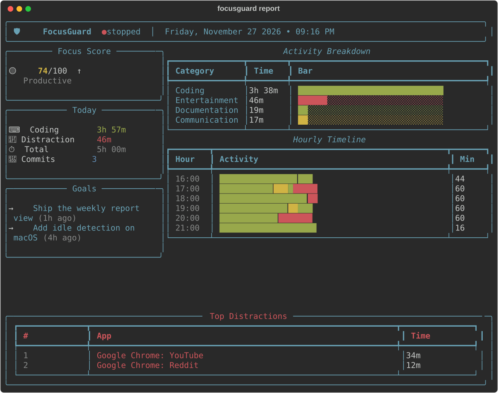
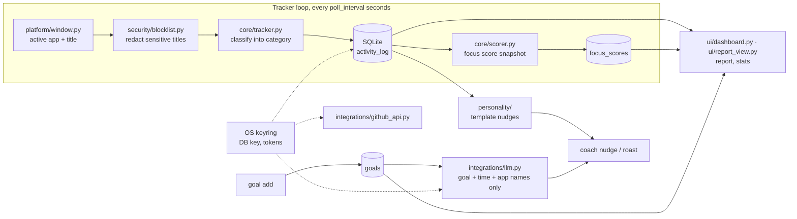
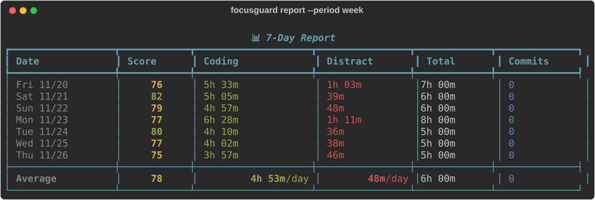
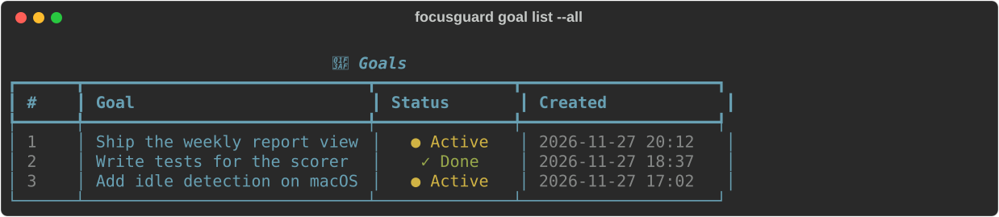
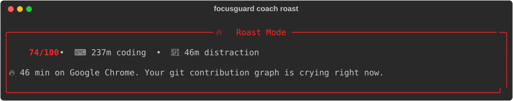
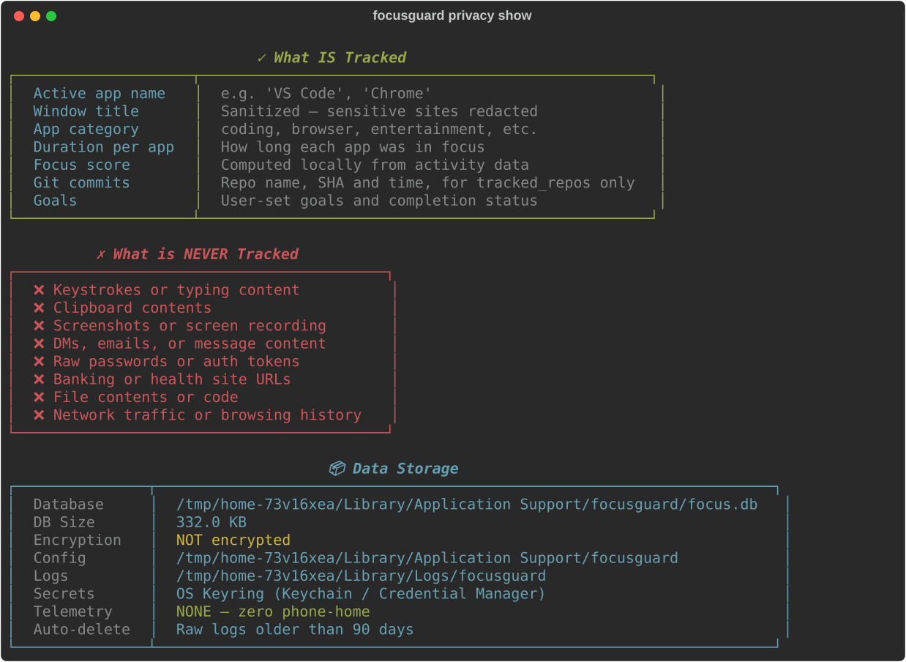
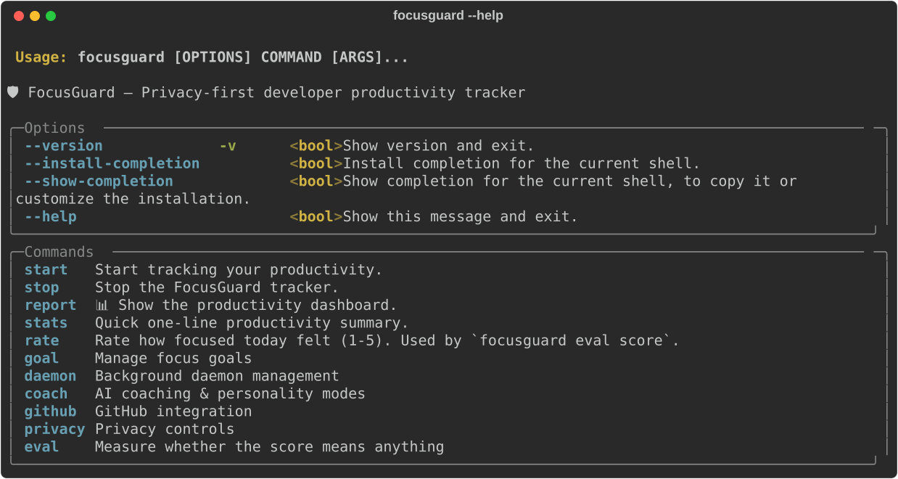

# FocusGuard

A local-first command-line tracker for developers. It records which app is in focus once a minute,
turns that into a 0–100 focus score, and shows the result as a terminal dashboard, with goals,
personality-mode nudges and an optional AI coach (Ollama locally, or OpenAI).

> **Status:** alpha (v0.1.0). The tracker, dashboard, reports, goals, personality modes, AI coach,
> GitHub summary and per-OS daemons work. The **procrastination engine, 90-day retention and git
> commit logging are written and unit-tested but not yet called by the app**, idle detection is a
> stub, and app classification has known false positives. See [Known issues](docs/05-known-issues.md)
> before trusting a score.



<sub>All screenshots use synthetic demo data. Regenerate them with `python scripts/screenshots.py`.</sub>

## Architecture



Module map, schema and design rules: [docs/01-architecture.md](docs/01-architecture.md).

## What it looks like

| Quick stats and weekly report | Goals and roast mode |
| --- | --- |
|   |   |

<details>
<summary><code>focusguard privacy show</code> and <code>focusguard --help</code></summary>




</details>

## What works and what doesn't

| Feature | State | Where |
| --- | --- | --- |
| Active-window polling (macOS, Windows, Linux X11) | Works. macOS needs Accessibility permission. | `platform/window.py` |
| Sensitive-title redaction | Works on window titles. Substring match, so it over-redacts; app names are not filtered. | `security/blocklist.py` |
| Focus score with time decay | Works. Only as good as the classifier feeding it. | `core/scorer.py` |
| Dashboard, `stats`, week/month report | Works. The report's "Commits" column is always 0. | `ui/` |
| Goals | Works. | `commands/goal.py` |
| Personality modes (template messages) | Works. `coach mode X` does not save the mode yet. | `personality/` |
| AI coach (Ollama / OpenAI) | Works when enabled. | `integrations/llm.py` |
| GitHub summary, local repo scan | Works (`.[github]` extra). | `integrations/` |
| Background daemon | launchd, systemd user unit and Task Scheduler. | `platform/daemon_*.py` |
| Encrypted database | Only with the `.[encrypted]` extra. The default install is **plain SQLite**. | `db/connection.py` |
| Idle detection | **Stub.** Always "not idle", so time away with an editor open counts as coding. | `core/tracker.py` |
| Procrastination engine | **Not wired in.** Unit-tested, never called. | `core/pattern_engine.py` |
| 90-day retention | **Not wired in.** `run_retention_policy()` is never called. | `core/retention.py` |
| Git commit logging | **Not wired in.** `log_git_event()` is never called. | `db/queries.py` |
| `privacy blocklist add/remove` | **Prints success, saves nothing.** Edit `config.toml` instead. | `commands/privacy.py` |

The details, with reproductions, are in [docs/05-known-issues.md](docs/05-known-issues.md). The fix
order is in [docs/06-roadmap.md](docs/06-roadmap.md).

## Run it

FocusGuard is **not on PyPI.** `pip install focusguard` installs an unrelated package with the same
name. Install from source:

```bash
git clone https://github.com/Dhruv-Sharma29/FocusGuard.git && cd FocusGuard
python3 -m venv .venv && source .venv/bin/activate
pip install -e ".[encrypted]"        # add ai, github or dev as needed: ".[encrypted,ai,github]"
focusguard start                     # foreground; Ctrl+C to stop
focusguard report                    # in another terminal
```

Step-by-step setup (daemon, AI coach, GitHub, config, uninstall): [start.md](start.md).
Every command: [docs/04-cli-reference.md](docs/04-cli-reference.md).

## Privacy in one paragraph

Everything stays on your machine unless you turn on the AI coach with the OpenAI provider or run a
`github` command. Window titles that match the blocklist are stored as `[private]`, secrets (DB key,
GitHub token, OpenAI key) live in the OS keyring, and there is no telemetry. Three of the
privacy screen's own claims are not true yet: retention never runs, the database is unencrypted
unless you install the `encrypted` extra, and blocklist edits from the CLI aren't saved. Full
account: [docs/03-privacy-and-security.md](docs/03-privacy-and-security.md).

## Development

```bash
pip install -e ".[dev]"
pytest                    # 78 tests, ~25% line coverage; CLI commands and UI are untested
ruff check src            # 94 findings today, 48 auto-fixable
mypy src                  # strict mode: 31 errors today
python scripts/screenshots.py   # regenerate docs/images/
```

## Docs

Start with [start.md](start.md) to run it. The design record is in [docs/](docs/README.md):

| # | Doc | What it settles |
| --- | --- | --- |
| 00 | [Charter](docs/00-charter.md) | Problem, who it's for, scope, how success should be measured |
| 01 | [Architecture](docs/01-architecture.md) | Poll loop, module map, schema, design rules |
| 02 | [Tracking and scoring](docs/02-tracking-and-scoring.md) | Classification, the score formula, the procrastination engine |
| 03 | [Privacy and security](docs/03-privacy-and-security.md) | What is stored, redaction, encryption, what reaches an LLM |
| 04 | [CLI reference](docs/04-cli-reference.md) | Every command and option, config file location and keys |
| 05 | [Known issues](docs/05-known-issues.md) | Verified bugs and gaps, each with a reproduction |
| 06 | [Roadmap](docs/06-roadmap.md) | Fix order, definition of done for v0.2 |

## License

MIT. See [LICENSE](LICENSE).
