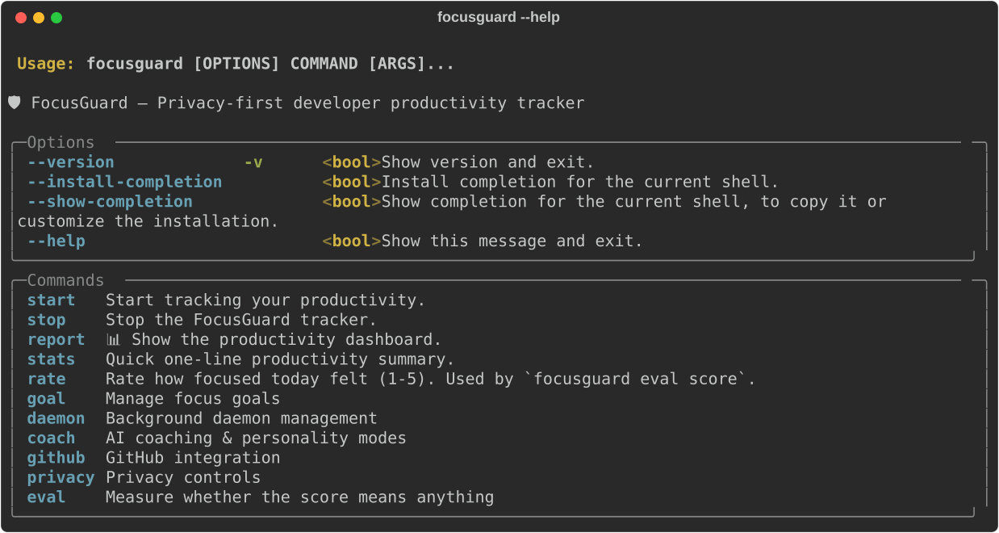
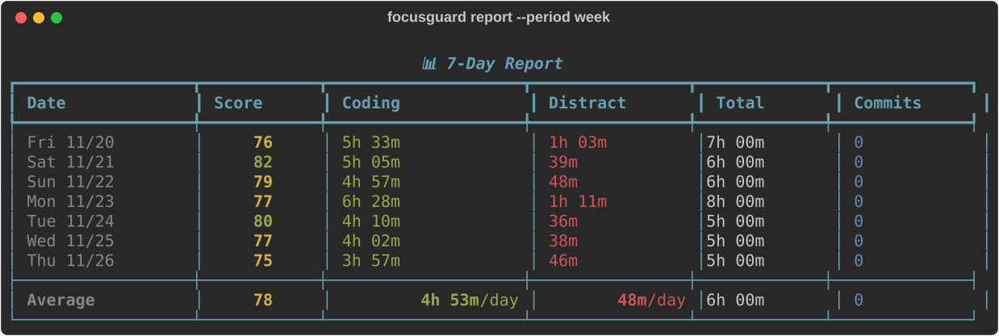
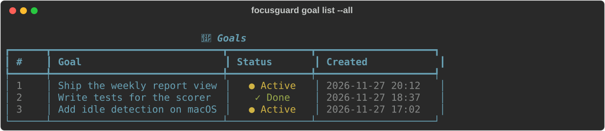
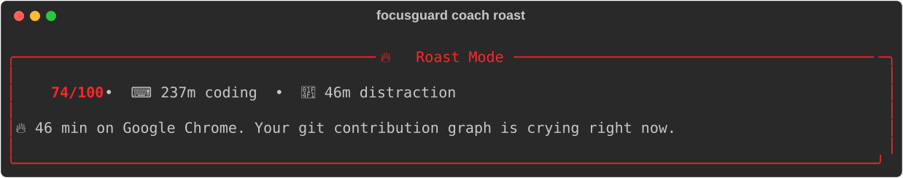
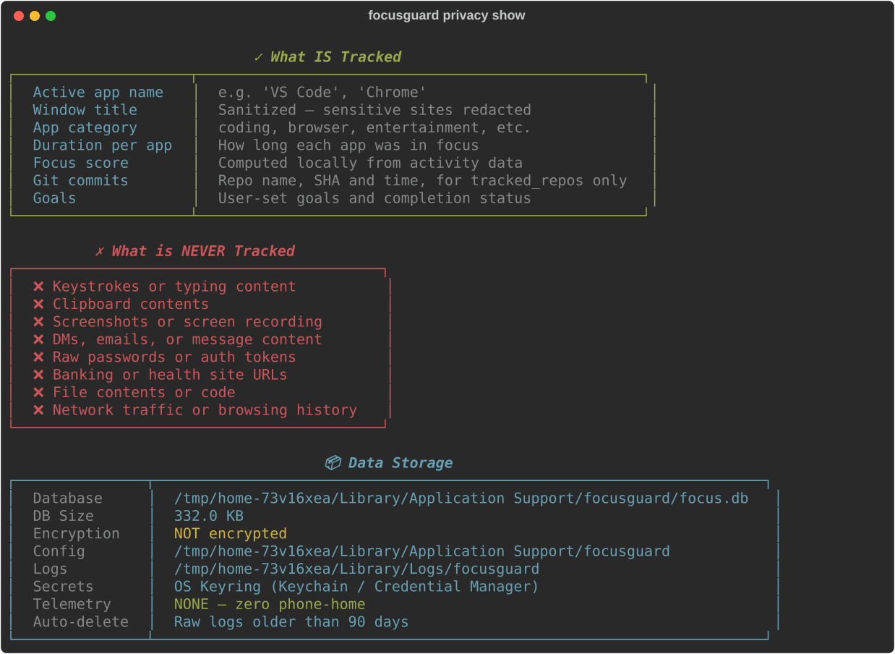

# 04 — CLI reference

`focusguard --help` lists the groups; every command takes `--help`. Options are shown with their
defaults. Behaviour notes flag where a command doesn't do what its output says.

## Tracking

| Command | Does |
| --- | --- |
| `focusguard start` | Run the tracker in the foreground. Ctrl+C stops it. Refuses if a tracker is already running. |
| `focusguard start -d` / `--daemon` | Start a detached tracker (`--daemon-mode` child) and return. Lives until logout or `stop`. Refuses when the OS daemon is installed. |
| `focusguard stop` | SIGTERM the tracker from the PID file, wait up to 5 s. |
| `focusguard stats` | One line: score, trend, coding and distraction time today, since the first activity today. |
| `focusguard report` | Full dashboard for today. |
| `focusguard report -p week` · `-p month` | Per-day table for the last 7 / 30 days, including commits per day (from `[github] tracked_repos`) and your rating. |

## Measuring: `focusguard rate` and `focusguard eval …`

| Command | Does |
| --- | --- |
| `rate <1-5>` · `--date YYYY-MM-DD` · `--note TEXT` | Store how focused the day felt (default today; re-rating replaces). Shown in the `Rated` column of `report -p week`. |
| `eval titles FILE.csv` | Write every distinct (app, title) pair with minutes and the current classifier's guess, plus an empty `label` column. Refuses to overwrite. The file holds your window titles: keep it private. |
| `eval classifier FILE.csv` | Compare the classifier with your labels: per-category precision/recall, exact accuracy, and productive/distraction/neutral accuracy. Unknown labels are listed and skipped. |
| `eval score` · `-d 60` | For rated days with activity: Spearman ρ of the daily score vs rating, and of the plain productive ratio vs rating. |
| `eval idle` · `-m 20` | What was logged in the last N minutes, for the walk-away idle test. |

## Goals: `focusguard goal …`

| Command | Does |
| --- | --- |
| `add "text"` | Create an active goal; prints its id. |
| `list` · `list -a` / `--all` | Active goals; `--all` adds done and dropped ones. |
| `complete <id>` | Mark done (sets `completed_at`). Exit 1 if not found or already inactive. |
| `drop <id>` | Deactivate without completing. |

## Coach and personality: `focusguard coach …`

| Command | Does |
| --- | --- |
| `nudge` | Message in the configured mode: LLM if `[ai] enabled`, else a local template. |
| `roast` (also top-level `focusguard roast`) | Same, always in roast mode. |
| `help` · `help -b` / `--breakdown` | Ask the LLM about your newest active goal; `-b` asks for subtasks. Without AI enabled, or if the LLM call fails, it prints your goal, time on it and recent apps. Hidden alias: `focusguard help-me`. |
| `mode <coach\|strict\|friend\|roast>` | Switch and save `[personality] mode`. |
| `enable` · `enable -p openai` | Set `[ai] enabled = true` and the provider (default `ollama`); rewrites the config file. |
| `disable` | Set `[ai] enabled = false`. |
| `setup-openai` | Prompt (hidden) for an OpenAI key and store it in the keyring. |

Modes: **coach** (encouraging), **strict** (direct), **friend** (casual, avoids numbers),
**roast** (savage). Each has its own colour theme in the dashboard.

## GitHub: `focusguard github …` (needs `.[github]`)

| Command | Does |
| --- | --- |
| `setup` | Prompt (hidden) for a personal access token; store it in the keyring. |
| `summary` · `summary -d 30` | Commits, PRs opened/merged, issues opened/closed over N days (default 7), across your repos pushed in that window. Makes one or more API calls per repo, so it's slow with many repos. |
| `repos [PATH]` | Find git repos under PATH (default `~/Code`, depth 3) and show commits in 24 h and 7 d, lines changed and a dirty flag. Local only. |

## Daemon: `focusguard daemon …`

| Command | Does |
| --- | --- |
| `install` | Write and load the launchd plist / systemd user unit / scheduled task (see [start.md § 4](../start.md#4-survive-reboots-daemon)). |
| `uninstall` | Unload and remove it. |
| `status` | Running or not, with PID, from the PID file. |

## Privacy: `focusguard privacy …`

| Command | Does |
| --- | --- |
| `show` | What is and isn't tracked, file paths, whether the DB is encrypted, retention setting. |
| `blocklist` · `blocklist list` | Print the active patterns. |
| `blocklist add 
` · `blocklist remove 
` | Add or remove a pattern and save the config. `remove` exits 1 if the pattern isn't there. Restart a running tracker to apply. |
| `encrypt` | Convert an existing unencrypted database to SQLCipher (needs `sqlcipher3`; stop the tracker first). Copies, verifies row counts, then replaces. |
| `export-key` | Print the database encryption key, for backup. |
| `uninstall` · `uninstall -y` | Stop the tracker, remove the daemon, delete data/config/log folders and the keyring entries. Irreversible. |

## Global options

| Option | Does |
| --- | --- |
| `-v`, `--version` | Print the version. |
| `--install-completion` / `--show-completion` | Shell completion (Typer). |

## Config file

Keys, defaults and per-OS paths are in [start.md § 8](../start.md#8-configuration). Two behaviours
to know:

- Setting a list or table (`blocklist`, `app_categories`) **replaces** the built-in defaults.
- `coach enable`/`disable`/`mode` and `privacy blocklist add/remove` rewrite the whole file with
  every current value filled in, so comments in it are lost.
